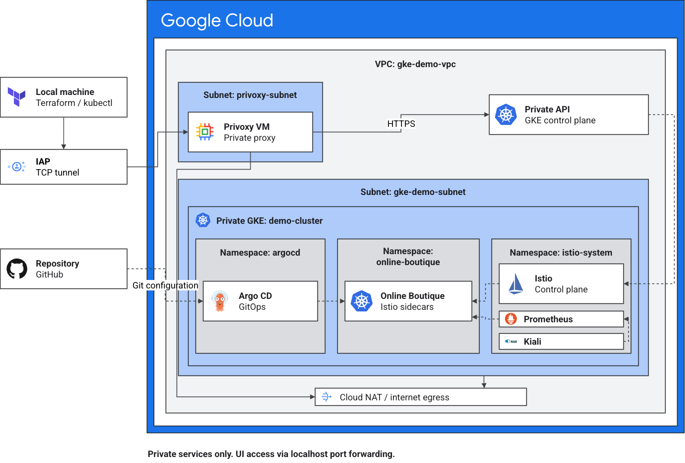

# gcp-microservices-demo

Deploying Google Cloud's [Online Boutique microservices demo](https://github.com/googlecloudplatform/microservices-demo) on GKE with Terraform, Helm, Argo CD, and Istio.

## Overview

A personal project exploring GCP infrastructure, Kubernetes, GitOps, and service
meshes. This repository contains the configuration used to deploy the environment
and describes its architecture. It is not intended as a reusable deployment
template or a production reference architecture.

## Architecture

- Terraform manages the GCP infrastructure and Helm releases.
- A private GKE cluster runs Online Boutique on Spot nodes.
- Argo CD deploys Online Boutique from its Helm chart using configuration stored in Git.
- Istio sidecars handle service-to-service traffic.
- Kiali and Prometheus provide service-mesh visualisation and traffic metrics.

## Access and cost considerations

The environment has no public load balancers. Access to the private cluster uses
an IAP tunnel and Privoxy, with localhost port forwarding for Online Boutique,
Argo CD, and Kiali.

Spot nodes reduce compute costs, while Prometheus uses ephemeral storage with
six-hour retention instead of a dedicated persistent disk. Metrics are lost when
the Prometheus pod is replaced. GCP charges still apply for resources such as
GKE nodes and their disks, the Privoxy VM, Cloud NAT, and billable network traffic.
GKE cluster-management fees may apply, depending on free-tier eligibility.
Istio, Kiali, and Prometheus consume node CPU and memory and may cause the node pool to scale up.
